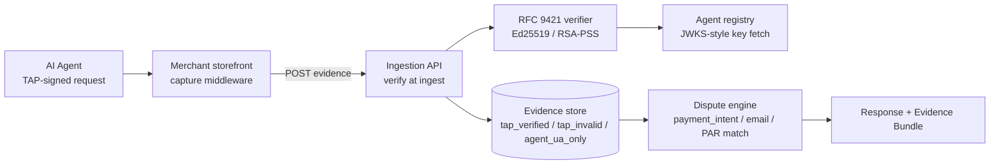

# Agentic checkout governance

Open-source evidence capture and signature verification for AI-agent purchases. When an AI agent buys from your store, this is the layer that proves what happened.

Built on Visa's Trusted Agent Protocol (TAP) and designed to slot in Mastercard Verifiable Intent as the spec lands. This is the governance half of agentic commerce: not "how do agents buy", but "how do merchants prove who bought".

## Why this exists

AI agents are already transacting. When one of those transactions turns into a chargeback, the merchant has no evidence that a verified, consented agent acted on the cardholder's behalf. Mastercard's position: merchants who cannot access intent evidence lose dispute protection. No chargeback tool on the market captures this. That gap is why this repo is public.

The core problem is technical and narrow: TAP signs HTTP requests with RFC 9421 message signatures. Someone has to capture those signatures at the storefront edge, verify them against the agent registry at ingestion, and bind the result to the eventual dispute. This package does exactly that.

## Architecture

Design decisions that matter:

- **Verification at ingestion, not at dispute time.** The signature is checked the moment evidence arrives, with a nonce replay guard. An attestation produced at ingest is stronger evidence than one reconstructed weeks later.
- **Three-way dispute matching**: payment_intent_id, then customer email, then PAR. Store all three when available.
- **Protocol-agnostic rows.** The schema carries a `protocol` field, so Mastercard Verifiable Intent evidence lands in the same table without a migration.
- **No cardholder data.** Signatures, PAR and hashed emails are not PAN. Capture never touches card numbers.

## What's in the repo

**`packages/tap-capture`**: the capture SDK, ~2 kB in the middleware path, zero dependencies:

- `captureNext(config)`: Next.js middleware wrapper. Detects the Signature-Agent header, collects Signature-Input / Signature / authority and consented identifiers, POSTs to ingestion fire-and-forget (never blocks the request), dedupes per nonce.
- `captureExpress(config)` / `captureFastify(config)`: same for Node servers.
- `classifyAgentUA(ua)`: classifies agent traffic by user agent (OpenAI Operator, Claude, Perplexity, Nova, unknown bot, human). Powers traffic telemetry that works today, before TAP traffic arrives at scale.
- Tests included, with RFC 9421 fixtures.

**`workers/tap-capture-worker`**: a single-file Cloudflare Worker with the same detection and forward logic, KV-based nonce dedupe. Copy-paste or `wrangler deploy`. Three-minute install for stores on Cloudflare.

**`lib/`**: the server-side verification stack, reference implementation:

- `verifier.ts`: RFC 9421 signature verification (Ed25519 and RSA-PSS-SHA256), expiry checks, replay guard
- `registry.ts`: agent registry key fetch, JWKS-style, cached
- `match.ts`: dispute-to-evidence matching (payment_intent / email / PAR cascade)
- `response-block.ts`: generates the "authorized agent transaction" block injected into dispute responses

## Verified dispositions

Every captured request lands in one of three buckets:

| Classification | Meaning | Dispute posture |
|---|---|---|
| `tap_verified` | Signature valid, registry key matches, nonce fresh | Agent transaction confirmed: strong evidence for the issuer |
| `tap_invalid` | Signature present but fails verification | Suspicious agent activity: defensive context |
| `agent_ua_only` | Agent-shaped UA, no signature | Telemetry only, no protection claim |

The Evidence Bundle export wraps a verification attestation, signature parameters, timeline and a plain-language framing into a branded PDF an issuer can actually read.

## Status

In production use as part of ChargeGuard's agentic evidence stack. This repo is the open, merchant-side half: the capture SDK and the verifier. The dispute engine, dashboard and ingestion API stay in the product.

The timing bet is deliberate: TAP traffic is near zero today, but agent UA telemetry is useful immediately, capture waits passively at essentially zero cost, and when the wave arrives the evidence infrastructure already exists. Visa TAP and Mastercard Verifiable Intent both went live in 2026.

## Stack

TypeScript, WebCrypto / node:crypto, jose, RFC 9421, Cloudflare Workers KV. vitest across the board.

---

*MIT on the capture package and worker. Server-side `lib/` is reference code: read it, run it, adapt it.*
